<!--
  Akash Sakala · GitHub profile
  The animations in assets/*.webp are HTML rendered to video with HyperFrames.
  Source: profile-src/ · rebuilt by .github/workflows/render-profile-assets.yml
-->

<a href="https://github.com/Akash-Sakala">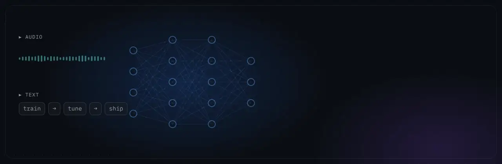</a>

I train, fine-tune and ship models: LLM post-training and distillation, speech recognition, and vision and audio models. When a model needs a product around it, I build that too. I'm an **Associate Applications Developer at Oracle** (Java, Spring Boot). Before that, as an **AI Research Intern at Voibe**, I distilled a 120B LLM into a 4B model that kept 99.4% of the teacher's score.

| **120B → 4B** | **9.16% → 4.51%** | **91.3%** | **+29 pts** |
| :---: | :---: | :---: | :---: |
| LLM distilled, 99.4% of the teacher's score, 1 GPU instead of many | Whisper word error rate on Indian English, with a 42 MB LoRA | ESC-50 sound classification (humans: 81.3%) | macro-F1 from quantum-circuit features with 64 training farms |

## Selected work

<a href="https://github.com/Akash-Sakala/AgriQNet-2.0">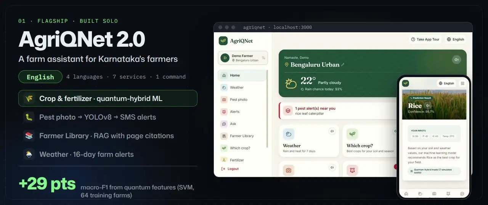</a>

**[AgriQNet 2.0](https://github.com/Akash-Sakala/AgriQNet-2.0)**: a farm assistant for Karnataka's farmers, built solo as my capstone. Seven services start with one command and work in Kannada, Hindi, Telugu and English:

- Crop and fertilizer recommenders that add quantum-circuit features to classical models. Each one is tested against its classical twin with nested cross-validation.
- YOLOv8 names a pest from a photo, then an SMS warns farmers in nearby districts.
- A RAG library over ICAR and UAS farm books that cites the page for every answer.
- District weather alerts.

`React` `Node.js` `FastAPI` `MongoDB` `scikit-learn` `NumPy circuit simulator` `YOLOv8` `RAG`

<table>
<tr>
<td width="50%" valign="top">
<a href="https://github.com/Akash-Sakala/ai-podcast-clipper">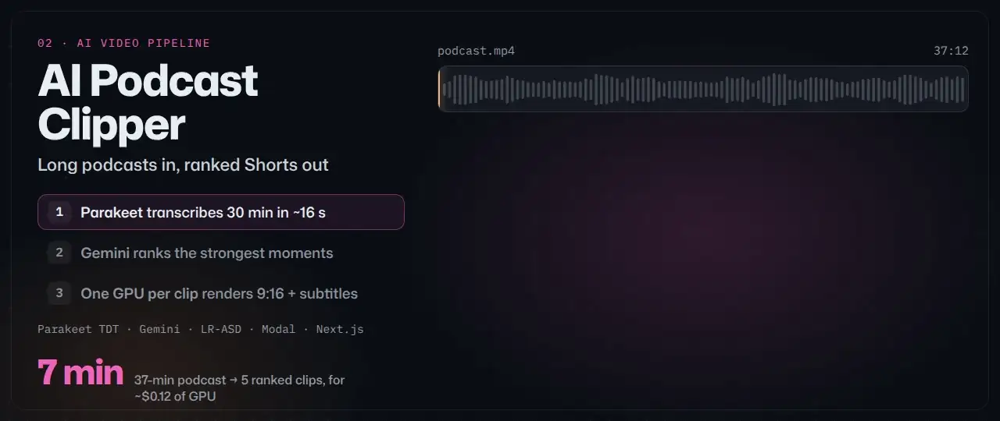</a>
 
<b><a href="https://github.com/Akash-Sakala/ai-podcast-clipper">AI Podcast Clipper</a></b>: paste a YouTube link and get ranked 9:16 Shorts. The crop follows whoever is speaking, and subtitles are timed to each word. It's a local-first fork of <a href="https://github.com/Andreaswt/ai-podcast-clipper-saas">ai-podcast-clipper-saas</a> that I rebuilt around Parakeet transcription, Gemini ranking and one GPU per clip.
 <code>Python</code> <code>Modal</code> <code>Parakeet</code> <code>Gemini</code> <code>Next.js</code>
</td>
<td width="50%" valign="top">
<a href="https://github.com/Akash-Sakala/audio-cnn">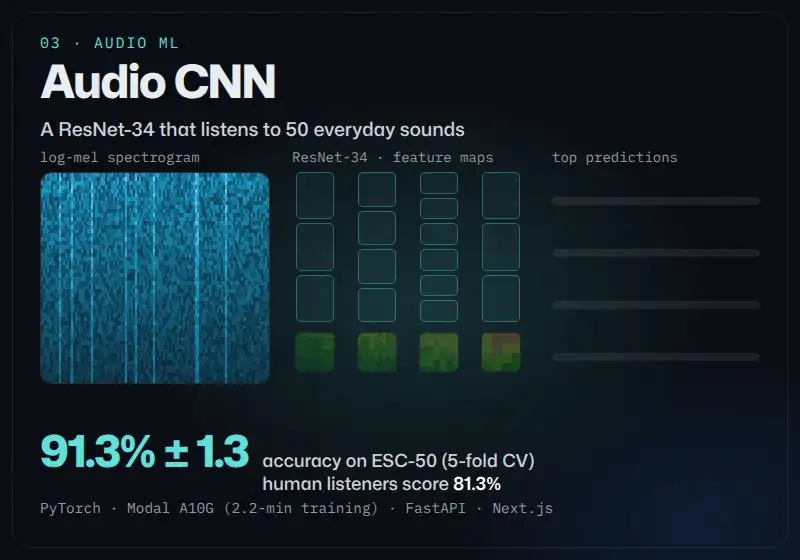</a>
 
<b><a href="https://github.com/Akash-Sakala/audio-cnn">Audio CNN</a></b>: a ResNet-34 for 50 environmental sounds. ImageNet transfer, SpecAugment and EMA took accuracy from 83.0% to 91.3%, and a GPU-resident pipeline cut training from 48 to 2.2 minutes. It runs offline on a CPU, with a dashboard of 37 layer-by-layer feature maps.
 <code>PyTorch</code> <code>Modal</code> <code>FastAPI</code> <code>Next.js</code> · <a href="https://huggingface.co/Akash-Sakala/audio-cnn-resnet34-esc50">🤗 model</a>
</td>
</tr>
<tr>
<td width="50%" valign="top">
<a href="https://github.com/Akash-Sakala/Kriya-AI">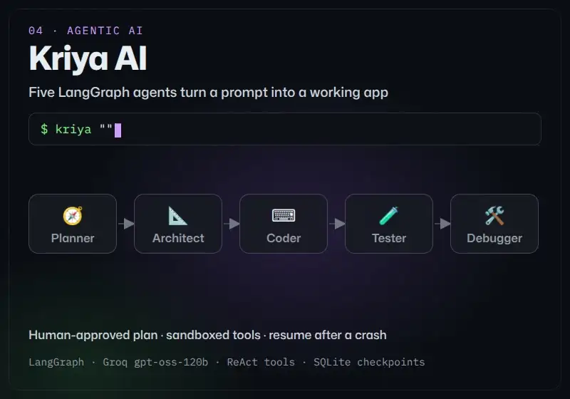</a>
 
<b><a href="https://github.com/Akash-Sakala/Kriya-AI">Kriya AI</a></b>: a CLI where five LangGraph agents turn a prompt into a working app. A tester and a debugger repair failures in a loop. It falls back to another model on errors, uses sandboxed tools, and can resume after a crash.
 <code>LangGraph</code> <code>Groq</code> <code>Pydantic</code> <code>SQLite</code>
</td>
<td width="50%" valign="top">

### 🤗 Model lab

Ten models and two datasets on [Hugging Face](https://huggingface.co/Akash-Sakala), mostly about **making models smaller without losing quality**:

- **LLM distillation**: [gpt-oss-120b](https://huggingface.co/Akash-Sakala/gpt-oss-120b-transcript-formatter-lora) → [20b](https://huggingface.co/Akash-Sakala/gpt-oss-20b-transcript-formatter-lora) → [Qwen3.5-4B](https://huggingface.co/Akash-Sakala/qwen3.5-4b-transcript-formatter-lora), 99.4% vs the teacher's 99.9%
- **Speech**: [Whisper-small LoRA](https://huggingface.co/Akash-Sakala/whisper-small-emotion) (WER 9.16% → 4.51%) and a [Whisper-large-v3 QLoRA](https://huggingface.co/Akash-Sakala/whisper-large-v3-svarah-indic) on Indian-accented English
- **Distil, then quantize**: [BERT → DistilBERT → 4-bit](https://huggingface.co/Akash-Sakala/bert-phishing-classifier_student_4bit), 4× smaller and more accurate than the teacher

[See the family trees ↓](#-model-lab-on-hugging-face)

</td>
</tr>
</table>

## Journey

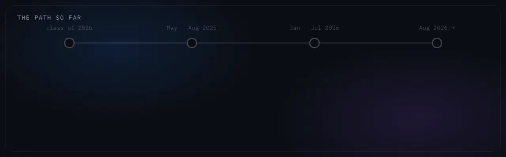

<b>Details by role</b>

 

- **Oracle**, Associate Applications Developer (Aug 2026 to now): enterprise Java and Spring Boot.
- **Voibe**, AI Research Intern, voice AI (Jan to Jul 2026):
  - Distilled a 120B teacher into a 4B student for ASR transcript formatting, using cross-tokenizer SFT and RLVR. Serving went from a multi-GPU MoE deployment to one INT4 GPU.
  - Cut Whisper's WER on Indian English from 9.16% to 4.51% with a LoRA trained on a custom set of 6,000 clips.
  - Built a crash-safe evaluation harness and a self-hosted WhisperX + pyannote pipeline that replaced paid ASR APIs.
- **Netradyne**, SDET Intern, Analytics (May to Aug 2025):
  - Built a pySerial/Linux framework that cut IoT flashing and OTA installs from 2.5 hours to 40 minutes. Two teams (32+ engineers) use it.
  - Automated RMA lookups from about 5 minutes to under 60 seconds.
- **BMS College of Engineering**, B.E. in AI & Machine Learning, CGPA 9.73/10, class of 2026.

## 🤗 Model lab on Hugging Face

**Transcript formatting at Voibe:** a 120B teacher distilled down to a 4B student.

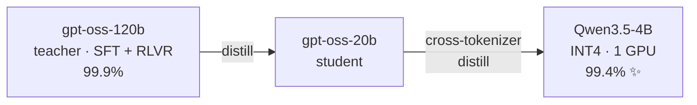

**Phishing URL classifier:** distil, then quantize.

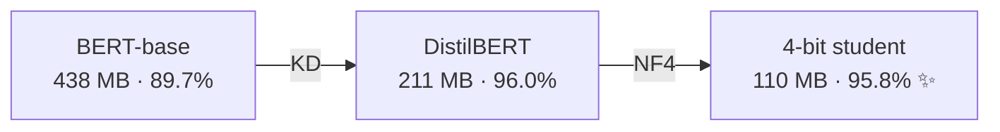

| Model | Task | Highlight |
| :--- | :--- | :--- |
| **[qwen3.5-4b-transcript-formatter-lora](https://huggingface.co/Akash-Sakala/qwen3.5-4b-transcript-formatter-lora)** | Transcript formatting | Distilled 4B student, **99.4%** vs the 120B teacher's 99.9% |
| [gpt-oss-20b](https://huggingface.co/Akash-Sakala/gpt-oss-20b-transcript-formatter-lora) · [gpt-oss-120b](https://huggingface.co/Akash-Sakala/gpt-oss-120b-transcript-formatter-lora) · [flan-t5-large](https://huggingface.co/Akash-Sakala/flan-t5-large-transcript-formatter) | Transcript formatting | Teacher, intermediate student and baseline in the same lineage |
| **[whisper-small-emotion](https://huggingface.co/Akash-Sakala/whisper-small-emotion)** | Speech recognition | LoRA for Indian-English and expressive speech: WER **9.16% → 4.51%**, 42 MB adapter |
| [whisper-large-v3-svarah-indic](https://huggingface.co/Akash-Sakala/whisper-large-v3-svarah-indic) | Speech recognition | QLoRA (4-bit NF4) on AI4Bharat's Svarah, ~1% of parameters trained |
| **[bert-phishing-classifier_student_4bit](https://huggingface.co/Akash-Sakala/bert-phishing-classifier_student_4bit)** | Text classification | Distil, then quantize: **4× smaller** than the teacher and more accurate |
| **[audio-cnn-resnet34-esc50](https://huggingface.co/Akash-Sakala/audio-cnn-resnet34-esc50)** | Audio classification | **93.25%** top-1 on a held-out fold, ~57 ms per clip on CPU |
| [phishing-site-classification](https://huggingface.co/datasets/Akash-Sakala/phishing-site-classification) · [transcript-formatter-curriculum](https://huggingface.co/datasets/Akash-Sakala/transcript-formatter-curriculum) | Datasets | The training data behind the models above |

## Toolbox

 

 

 

## Activity

 

🕹️ <b>Insert coin</b>: Pac-Man eats my contribution graph

 
<picture>
  <source media="(prefers-color-scheme: dark)" srcset="https://raw.githubusercontent.com/Akash-Sakala/Akash-Sakala/output/pacman-contribution-graph-dark.svg" />
  <source media="(prefers-color-scheme: light)" srcset="https://raw.githubusercontent.com/Akash-Sakala/Akash-Sakala/output/pacman-contribution-graph.svg" />
  
</picture>

🧰 <b>More from the workshop</b>: earlier builds and learning projects

 

| Repo | Notes |
| :--- | :--- |
| [Edu-Streamliners](https://github.com/Akash-Sakala/Edu-streamliners) | School platform: plain-English questions over MongoDB, a Gemini lesson planner and offline attendance, shipped in Docker |
| [Chethana AI](https://github.com/Akash-Sakala/Chethana_AI) | Flask app that predicts 42 diseases from symptoms, with diet and workout plans, Mapbox clinic search and Twilio reminders |
| [AgriQNet v1](https://github.com/Akash-Sakala/AgriQNet) · [agri-rag](https://github.com/Akash-Sakala/agri-rag) · [pest_detection_yolo](https://github.com/Akash-Sakala/pest_detection_yolo) · [agro_backend](https://github.com/Akash-Sakala/agro_backend) | The first version of AgriQNet and its services, before 2.0 |
| [own-web-server](https://github.com/Akash-Sakala/own-web-server) · [PyGit](https://github.com/Akash-Sakala/PyGit) | An HTTP server and Git internals, built from scratch in Python |
| [node-email-service](https://github.com/Akash-Sakala/node-email-service) · [weather-app](https://github.com/Akash-Sakala/weather-app) · [ai-mentor-saas-app](https://github.com/Akash-Sakala/ai-mentor-saas-app) | A Nodemailer plugin, a Dockerized React weather app and a Next.js AI-mentor experiment |

---

Happy to talk about distillation, speech models, or anything that runs faster than it should. 
<a href="https://www.linkedin.com/in/akash-s-s/">LinkedIn</a> · <a href="https://huggingface.co/Akash-Sakala">Hugging Face</a> · <a href="mailto:akashsakala04@gmail.com">akashsakala04@gmail.com</a>

The animations on this page are HTML rendered to video with <a href="https://github.com/heygen-com/hyperframes">HyperFrames</a>. Source: <a href="https://github.com/Akash-Sakala/Akash-Sakala/tree/main/profile-src">profile-src/</a>

